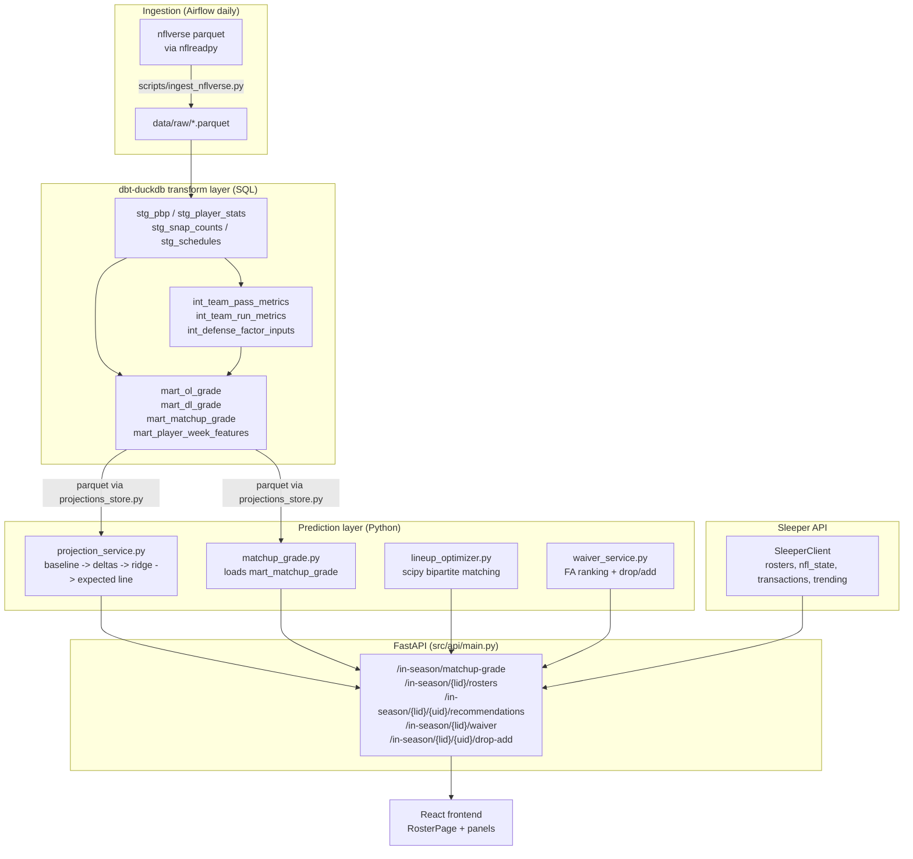
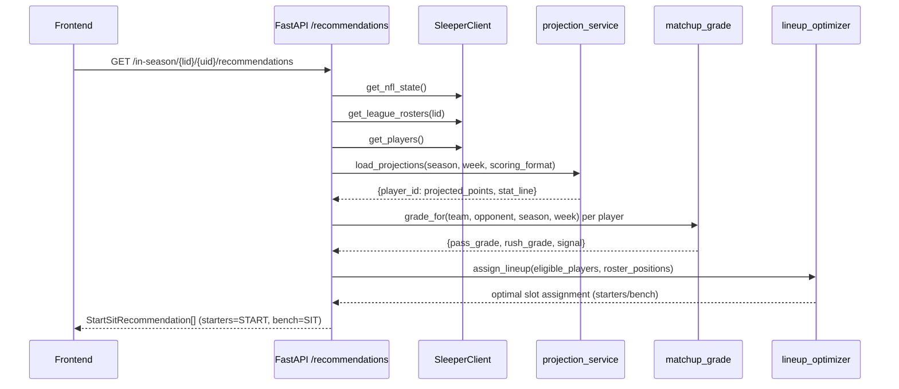

# Design Document: In-Season Matchup Recommendations

## Overview

Adds the in-season half of LineupLines: a dbt-duckdb SQL layer derives team
pass-rush/run-block OL/DL proxy metrics and a per-player-week feature mart from
free nflverse play-by-play data, a Python prediction layer (refactored from
`research/`) produces projected stat lines and an OL/DL matchup grade, and new
FastAPI endpoints surface start/sit and waiver recommendations for a user's
real Sleeper roster. The existing draft-only features remain untouched; every
in-season endpoint lives under `/api/v1/in-season/`.

## Architecture



### End-to-end request flow (start/sit recommendation)



### Separation of concerns

dbt-duckdb owns **data transformation** (staging → intermediate → marts with
tests, docs, lineage). Python owns **prediction/modeling** (baseline deltas,
ridge regression, scoring, lineup optimization). dbt never predicts; Python
never transforms raw data. The boundary is the mart parquet: dbt writes it,
Python reads it via `projections_store.py` (S3 in prod, local in dev).

## Components and Interfaces

The in-season feature is built from five Python services plus four dbt model
groups. Each component has a single responsibility and a documented interface.

### Component: projections_store.py

**Purpose**: parquet I/O abstraction for dbt marts and projection output. S3 in
prod (env `MART_S3_BUCKET`), local `data/` in dev. Mirrors the existing
`adp_sources.py` / `environment_score.py` S3-fallback pattern.

**Interface**:
```python
def load_mart(name: str, season: Optional[int] = None) -> pl.DataFrame
def load_projections(season: int, week: int, scoring_format: str) -> pl.DataFrame
def write_projections(df: pl.DataFrame, season: int, week: int, scoring_format: str) -> None
```

**Responsibilities**:
- Resolve mart parquet from S3 or local path
- Graceful degradation: missing mart returns empty DataFrame, never raises
- Filter by season when requested

### Component: matchup_grade.py

**Purpose**: serve the OL/DL matchup grade for a `(team, opponent, season, week)`
query. Reads `mart_matchup_grade` via `projections_store`.

**Interface**:
```python
class MatchupGradeService:
    def grade_for(self, team: str, opponent: str, season: int, week: int) -> MatchupGrade
```

**Responsibilities**:
- Lazy-load and cache the matchup mart
- Return a neutral default (all signals `"neutral"`, grades `0.0`) when no row
  matches — never raises

### Component: projection_service.py

**Purpose**: production projection pipeline. Reads dbt feature mart + defense
factor inputs, runs baseline → deltas → ridge → expected-line (refactored from
`research/model.py` v2 + `research/defense.py`), scores with league settings,
writes projection parquet.

**Interface**:
```python
class ProjectionService:
    def load_marts(self, season: int) -> None
    def project_week(self, season: int, week: int, scoring_settings: Dict[str, float]) -> List[Projection]
    def write_output(self, projections, season, week, scoring_format) -> None
```

**Responsibilities**:
- Preserve the no-future-leak guarantees from `research/`
- Fit per-channel ridge defense factors with prior-season weighting
- Output a 9-component stat line + projected points per player

### Component: lineup_optimizer.py

**Purpose**: optimal lineup assignment via max-weight bipartite matching
(`scipy.optimize.linear_sum_assignment`). Refactored from `research/assignment.py`.

**Interface**:
```python
def apply_exclusions(players: Sequence[OptimizerPlayer]) -> List[OptimizerPlayer]
def assign_lineup(players: Sequence[OptimizerPlayer], roster_positions: Sequence[str]) -> List[Optional[OptimizerPlayer]]
```

**Responsibilities**:
- Exclude bye/OUT/DOUBTFUL/IR/TAXI players
- Map flex slots to eligible positions
- Return the globally optimal assignment (not greedy)

### Component: waiver_service.py

**Purpose**: waiver wire recommendations. Phase 1 ranks FAs by projected points
(augmented with Sleeper trending adds); Phase 2 ranks drop/add pairs by net
projected points gained.

**Interface**:
```python
class WaiverService:
    def free_agent_ranking(self, league_id, season, week, scoring_format, position, limit) -> List[WaiverRec]
    def drop_add_optimization(self, league_id, user_id, season, week, scoring_format, limit) -> List[DropAddRec]
```

**Responsibilities**:
- Compute FA pool = all NFL players minus all rostered players league-wide
- Augment with Sleeper trending-add counts
- Only suggest drop/add pairs with positive net gain

### Component: SleeperClient extensions

**Purpose**: add in-season Sleeper API methods to the existing client, reusing
`_make_request` and rate limiting.

**Interface**:
```python
def get_league_rosters(self, league_id: str) -> List[Roster]
def get_nfl_state(self) -> Optional[Dict[str, Any]]
def get_league_transactions(self, league_id: str, week: int) -> List[Dict[str, Any]]
def get_trending_players(self, type: str, lookback_hours: int, limit: int) -> List[Dict[str, Any]]
```

**Responsibilities**:
- Normalize all IDs to strings (existing convention)
- Return empty lists / None on error (defensive, never raises)

## Data Models

### dbt table schemas

```sql
-- int_team_pass_metrics: (season, week, team, side, pressure_rate_trailing,
--   sack_rate_trailing, pass_epa_per_dropback_trailing, games_trailing)
-- int_team_run_metrics:  (season, week, team, side, stuff_rate_trailing,
--   yards_per_carry_trailing, run_epa_per_carry_trailing, games_trailing)

-- mart_ol_grade: (season, week, team, pass_protection_grade, run_blocking_grade,
--   ol_grade, games_trailing)
-- mart_dl_grade: (season, week, team, pass_rush_grade, run_defense_grade, dl_grade)
-- mart_matchup_grade: (season, week, team, opponent, pass_protection_grade,
--   run_blocking_grade, ol_grade, pass_rush_grade, run_defense_grade, dl_grade,
--   pass_matchup, rush_matchup, overall_matchup, pass_signal, rush_signal, overall_signal)

-- int_defense_factor_inputs: (season, week, team, opponent_team,
--   passing_yards, rushing_yards)
-- mart_player_week_features: (season, week, player_id, player_display_name,
--   position, team, opponent_team, <9 stat components>, target_share, carries,
--   team_carries, targets, attempts, offense_pct, implied_team_total, EPA cols)
```

**Validation rules**:
- Grade columns bounded [0, 100]; rate columns bounded [0, 1] (EPA in [-3, 3])
- `side ∈ {'off', 'def'}`; `signal ∈ {'favorable', 'neutral', 'unfavorable'}`
- Every scheduled game has a matchup row (relationships test)
- `mart_player_week_features` primary key `(player_id, season, week)` is unique

### Python data structures

```python
@dataclass
class Roster:                  # Sleeper roster (normalized IDs)
    roster_id: str; owner_id: str
    starters: List[str]; players: List[str]; reserve: List[str]

@dataclass
class MatchupGrade:           # matchup_grade service output
    team: str; opponent: str; season: int; week: int
    pass_matchup: Optional[float]; rush_matchup: Optional[float]
    overall_matchup: Optional[float]
    pass_signal: str; rush_signal: str; overall_signal: str
    ol_grade: Optional[float]; dl_grade: Optional[float]

@dataclass
class Projection:             # projection service output
    player_id: str; player_name: str; position: str; team: str
    opponent: Optional[str]
    expected_stat_line: Dict[str, float]  # all 9 components
    projected_points: float
    pass_factor: float; rush_factor: float
    baseline: Dict[str, float]

@dataclass
class OptimizerPlayer:        # lineup optimizer input
    player_id: str; position: str; expected_points: float
    on_bye: bool = False
    injury_status: Optional[str] = None
    roster_status: Optional[str] = None
    is_questionable: bool = field(init=False, default=False)

@dataclass
class WaiverRec:              # phase 1 waiver output
    player_id: str; player_name: str; position: str; team: str
    projected_points: Optional[float]
    trending_add_count: Optional[int] = None
    rank: int = 0

@dataclass
class DropAddRec:             # phase 2 drop/add output
    drop_player_id: str; drop_player_name: str; drop_projected_points: float
    add_player_id: str; add_player_name: str; add_projected_points: float
    position: str; net_gain: float; rank: int = 0
```

### API response models (Pydantic)

See the "API Endpoint Contracts" section for the full Pydantic model
definitions (`MatchupGradeResponse`, `RosterPlayer`, `RosterResponse`,
`LeagueRostersResponse`, `StartSitRecommendation`, `RecommendationsResponse`,
`WaiverRecResponse`, `WaiverResponse`, `DropAddRecResponse`,
`DropAddResponse`). All follow the existing `models.py` convention: `BaseModel`
with `ConfigDict.json_schema_extra` examples, `Field(..., description=...)`,
all IDs as strings.

---

## dbt Intermediate Models (Task 3)

### int_team_pass_metrics

Per team-game pass metrics from **both** the offensive (`posteam`) and defensive
(`defteam`) perspective, distinguished by a `side` column. This single model
feeds both the OL grade (side = 'off') and DL grade (side = 'def').

```sql
-- {{ config(materialized='view') }}
-- Primary key: (season, week, team, side)
-- One row per team-game-perspective. 'off' = team on offense (OL view);
-- 'def' = team on defense (DL view). dropbacks = pass attempts + sacks + scrambles.

with plays as (
    select
        season, week, game_id, posteam, defteam,
        play_type, sack, qb_hit, qb_scramble, pass_attempt, rush_attempt, epa
    from {{ ref('stg_pbp') }}
    where play_type in ('pass', 'run')
      and (pass_attempt = 1 or rush_attempt = 1 or sack = 1 or qb_scramble = 1)
),

-- Offensive perspective: team is posteam (their OL is protecting)
off_game as (
    select
        season, week, posteam as team,
        sum(case when pass_attempt = 1 or sack = 1 or qb_scramble = 1 then 1 else 0 end) as dropbacks,
        sum(sack) as sacks,
        sum(qb_hit) as qb_hits,
        sum(case when epa is not null and (pass_attempt = 1 or sack = 1) then epa end) as pass_epa
    from plays
    group by season, week, posteam
),

-- Defensive perspective: team is defteam (their DL is rushing)
def_game as (
    select
        season, week, defteam as team,
        sum(case when pass_attempt = 1 or sack = 1 or qb_scramble = 1 then 1 else 0 end) as dropbacks,
        sum(sack) as sacks,
        sum(qb_hit) as qb_hits,
        -- negative EPA allowed = good DL; store raw, invert at grade time
        sum(case when epa is not null and (pass_attempt = 1 or sack = 1) then epa end) as pass_epa
    from plays
    group by season, week, defteam
),

team_game as (
    select 'off' as side, * from off_game
    union all
    select 'def' as side, * from def_game
),

per_game as (
    select
        season, week, team, side,
        dropbacks,
        sacks,
        qb_hits,
        cast(dropbacks as double) as _db,
        case when dropbacks > 0 then cast(sacks as double) / dropbacks else 0 end as sack_rate,
        case when dropbacks > 0 then cast(sacks + qb_hits as double) / dropbacks else 0 end as pressure_rate,
        case when dropbacks > 0 then pass_epa / dropbacks else 0 end as pass_epa_per_dropback
    from team_game
)

-- Rolling trailing average: expanding current-season window, prior-season
-- fallback. No future leak — only (season, week) strictly before the target.
select
    t.season, t.week, t.team, t.side,
    coalesce(
        avg(g.pressure_rate) filter (where g.season = t.season),
        avg(g.pressure_rate) filter (where g.season = t.season - 1)
    ) as pressure_rate_trailing,
    coalesce(
        avg(g.sack_rate) filter (where g.season = t.season),
        avg(g.sack_rate) filter (where g.season = t.season - 1)
    ) as sack_rate_trailing,
    coalesce(
        avg(g.pass_epa_per_dropback) filter (where g.season = t.season),
        avg(g.pass_epa_per_dropback) filter (where g.season = t.season - 1)
    ) as pass_epa_per_dropback_trailing,
    coalesce(
        count(*) filter (where g.season = t.season),
        count(*) filter (where g.season = t.season - 1)
    ) as games_trailing
from per_game t
left join per_game g
    on g.team = t.team and g.side = t.side
    and (g.season, g.week) < (t.season, t.week)
group by t.season, t.week, t.team, t.side
```

**Tests** (added to `intermediate/schema.yml`):
- `pressure_rate_trailing` between 0 and 1
- `sack_rate_trailing` between 0 and 1
- `pass_epa_per_dropback_trailing` between -3 and 3
- `games_trailing` not_null (every team-week has a row)
- monotonic `(season, week)` ordering per `(team, side)` — accepted via a
  custom singular test comparing min/max

### int_team_run_metrics

```sql
-- {{ config(materialized='view') }}
-- Primary key: (season, week, team, side)
-- stuff = run stopped at or behind LOS (yards_gained <= 0).

with run_plays as (
    select season, week, posteam, defteam, yards_gained, epa
    from {{ ref('stg_pbp') }}
    where play_type = 'run' and rush_attempt = 1
),

off_game as (
    select
        season, week, posteam as team,
        count(*) as carries,
        sum(yards_gained) as yards,
        sum(case when yards_gained <= 0 then 1 else 0 end) as stuffs,
        sum(epa) as run_epa
    from run_plays
    group by season, week, posteam
),

def_game as (
    select
        season, week, defteam as team,
        count(*) as carries,
        sum(yards_gained) as yards,
        sum(case when yards_gained <= 0 then 1 else 0 end) as stuffs,
        sum(epa) as run_epa
    from run_plays
    group by season, week, defteam
),

team_game as (
    select 'off' as side, * from off_game
    union all
    select 'def' as side, * from def_game
),

per_game as (
    select
        season, week, team, side, carries, yards,
        case when carries > 0 then cast(stuffs as double) / carries else 0 end as stuff_rate,
        case when carries > 0 then yards / cast(carries as double) else 0 end as yards_per_carry,
        case when carries > 0 then run_epa / cast(carries as double) else 0 end as run_epa_per_carry
    from team_game
)

select
    t.season, t.week, t.team, t.side,
    coalesce(
        avg(g.stuff_rate) filter (where g.season = t.season),
        avg(g.stuff_rate) filter (where g.season = t.season - 1)
    ) as stuff_rate_trailing,
    coalesce(
        avg(g.yards_per_carry) filter (where g.season = t.season),
        avg(g.yards_per_carry) filter (where g.season = t.season - 1)
    ) as yards_per_carry_trailing,
    coalesce(
        avg(g.run_epa_per_carry) filter (where g.season = t.season),
        avg(g.run_epa_per_carry) filter (where g.season = t.season - 1)
    ) as run_epa_per_carry_trailing,
    coalesce(
        count(*) filter (where g.season = t.season),
        count(*) filter (where g.season = t.season - 1)
    ) as games_trailing
from per_game t
left join per_game g
    on g.team = t.team and g.side = t.side
    and (g.season, g.week) < (t.season, t.week)
group by t.season, t.week, t.team, t.side
```

**Tests**: `stuff_rate_trailing` in [0,1]; `yards_per_carry_trailing` in [-5, 15];
`run_epa_per_carry_trailing` in [-3, 3]; no nulls on trailing averages.

---

## dbt Marts (Task 4)

### mart_ol_grade

Composite 0–100 OL grade per (team, season, week), built from the trailing
pass-protection and run-blocking percentiles. Percentile ranks are computed
**within each (season, week) snapshot** across all teams, so "90" means this
team's trailing run-blocking is better than 90% of the league at this point in
the season.

```sql
-- {{ config(materialized='table') }}
-- Primary key: (season, week, team)
-- Grade scale: 0-100, 50 = league average, higher = better OL.

with pass_m as (
    select season, week, team, pressure_rate_trailing, sack_rate_trailing, pass_epa_per_dropback_trailing
    from {{ ref('int_team_pass_metrics') }}
    where side = 'off'
),
run_m as (
    select season, week, team, stuff_rate_trailing, yards_per_carry_trailing, run_epa_per_carry_trailing
    from {{ ref('int_team_run_metrics') }}
    where side = 'off'
),

ranked as (
    select
        p.season, p.week, p.team,
        -- inverse percentiles: lower pressure/sack = better protection = higher pct
        (1 - percent_rank() over (partition by p.season, p.week order by p.pressure_rate_trailing)) * 100 as p_inv_pressure,
        (1 - percent_rank() over (partition by p.season, p.week order by p.sack_rate_trailing)) * 100 as p_inv_sack,
        percent_rank() over (partition by p.season, p.week order by p.pass_epa_per_dropback_trailing) * 100 as p_pass_epa,
        percent_rank() over (partition by p.season, p.week order by r.yards_per_carry_trailing) * 100 as r_ypc,
        percent_rank() over (partition by p.season, p.week order by r.run_epa_per_carry_trailing) * 100 as r_run_epa,
        (1 - percent_rank() over (partition by p.season, p.week order by r.stuff_rate_trailing)) * 100 as r_inv_stuff
    from pass_m p
    join run_m r using (season, week, team)
)

select
    season, week, team,
    -- pass protection sub-grade (60% of OL); run blocking sub-grade (40%)
    round(0.40 * p_inv_pressure + 0.25 * p_inv_sack + 0.35 * p_pass_epa, 2) as pass_protection_grade,
    round(0.40 * r_ypc + 0.35 * r_run_epa + 0.25 * r_inv_stuff, 2) as run_blocking_grade,
    round(0.60 * (0.40 * p_inv_pressure + 0.25 * p_inv_sack + 0.35 * p_pass_epa)
        + 0.40 * (0.40 * r_ypc + 0.35 * r_run_epa + 0.25 * r_inv_stuff), 2) as ol_grade,
    games_trailing  -- from the joined metrics, for transparency
from ranked
```

### mart_dl_grade

The defensive mirror. Same structure, but `side = 'def'` and the percentile
directions flip: higher pressure/sack = better DL, lower EPA allowed = better DL.

```sql
-- {{ config(materialized='table') }}
-- Primary key: (season, week, team)

with pass_m as (
    select season, week, team, pressure_rate_trailing, sack_rate_trailing, pass_epa_per_dropback_trailing
    from {{ ref('int_team_pass_metrics') }}
    where side = 'def'
),
run_m as (
    select season, week, team, stuff_rate_trailing, yards_per_carry_trailing, run_epa_per_carry_trailing
    from {{ ref('int_team_run_metrics') }}
    where side = 'def'
),

ranked as (
    select
        p.season, p.week, p.team,
        percent_rank() over (partition by p.season, p.week order by p.pressure_rate_trailing) * 100 as p_pressure,
        percent_rank() over (partition by p.season, p.week order by p.sack_rate_trailing) * 100 as p_sack,
        (1 - percent_rank() over (partition by p.season, p.week order by p.pass_epa_per_dropback_trailing)) * 100 as p_inv_epa,
        (1 - percent_rank() over (partition by p.season, p.week order by r.yards_per_carry_trailing)) * 100 as r_inv_ypc,
        (1 - percent_rank() over (partition by p.season, p.week order by r.run_epa_per_carry_trailing)) * 100 as r_inv_run_epa,
        percent_rank() over (partition by p.season, p.week order by r.stuff_rate_trailing) * 100 as r_stuff
    from pass_m p
    join run_m r using (season, week, team)
)

select
    season, week, team,
    round(0.40 * p_pressure + 0.25 * p_sack + 0.35 * p_inv_epa, 2) as pass_rush_grade,
    round(0.40 * r_inv_ypc + 0.35 * r_inv_run_epa + 0.25 * r_stuff, 2) as run_defense_grade,
    round(0.60 * (0.40 * p_pressure + 0.25 * p_sack + 0.35 * p_inv_epa)
        + 0.40 * (0.40 * r_inv_ypc + 0.35 * r_inv_run_epa + 0.25 * r_stuff), 2) as dl_grade
from ranked
```

### mart_matchup_grade

Joins the offense team's OL grade vs the opponent's DL grade per channel, then
joins to `stg_schedules` so **every scheduled game** has a matchup row. One row
per `(team, opponent, season, week)` from the offense's perspective — each game
produces two rows (home offense vs away defense, away offense vs home defense).

```sql
-- {{ config(materialized='table') }}
-- Primary key: (season, week, team, opponent)

with games as (
    -- explode every scheduled game into two offensive perspectives
    select season, week, home_team as team, away_team as opponent from {{ ref('stg_schedules') }}
    union all
    select season, week, away_team as team, home_team as opponent from {{ ref('stg_schedules') }}
),

matchup as (
    select
        g.season, g.week, g.team, g.opponent,
        ol.pass_protection_grade, ol.run_blocking_grade, ol.ol_grade,
        dl.pass_rush_grade, dl.run_defense_grade, dl.dl_grade,
        -- channel grades: offense sub-grade minus defense sub-grade (positive = offense favored)
        round(ol.pass_protection_grade - dl.pass_rush_grade, 2) as pass_matchup,
        round(ol.run_blocking_grade - dl.run_defense_grade, 2) as rush_matchup,
        round(ol.ol_grade - dl.dl_grade, 2) as overall_matchup
    from games g
    left join {{ ref('mart_ol_grade') }} ol
        on ol.season = g.season and ol.week = g.week and ol.team = g.team
    left join {{ ref('mart_dl_grade') }} dl
        on dl.season = g.season and dl.week = g.week and dl.team = g.opponent
)

select
    *,
    case
        when pass_matchup >  10 then 'favorable'
        when pass_matchup < -10 then 'unfavorable'
        else 'neutral'
    end as pass_signal,
    case
        when rush_matchup >  10 then 'favorable'
        when rush_matchup < -10 then 'unfavorable'
        else 'neutral'
    end as rush_signal,
    case
        when overall_matchup >  10 then 'favorable'
        when overall_matchup < -10 then 'unfavorable'
        else 'neutral'
    end as overall_signal
from matchup
```

**Tests** (marts/schema.yml):
- `ol_grade`, `dl_grade`, `pass_protection_grade`, etc. bounded [0, 100]
- `pass_signal` sign consistent with `pass_matchup` (custom test: `favorable`
  ⟹ `pass_matchup > 10`, etc.)
- every `(season, week, team)` in `stg_schedules` has a row in
  `mart_matchup_grade` (custom relationships test)

---

## dbt Feature Mart (Task 9)

### int_defense_factor_inputs

Team-game yardage by channel — the input matrix the Python ridge regression
reads. Mirrors `research/defense.py::team_games`.

```sql
-- {{ config(materialized='view') }}
-- Primary key: (season, week, team, opponent_team)

select
    season, week, team, opponent_team,
    sum(passing_yards) as passing_yards,
    sum(rushing_yards) as rushing_yards
from {{ ref('stg_player_stats') }}
where position in ('QB', 'RB', 'WR', 'TE')
group by season, week, team, opponent_team
```

### mart_player_week_features

Ports `research/model.py::build_feature_table` to SQL. One row per
(player, season, week) for QB/RB/WR/TE, carrying the 9-component stat line plus
every input the delta model needs. Snap counts join on a normalized display
name (same `_normalize_name` logic as the research model); implied team totals
come from `stg_schedules`.

```sql
-- {{ config(materialized='table') }}
-- Primary key: (player_id, season, week)

with stats as (
    select * from {{ ref('stg_player_stats') }}
    where position in ('QB', 'RB', 'WR', 'TE')
),

team_carries as (
    select season, week, team, sum(carries) as team_carries
    from stats group by season, week, team
),

snaps as (
    select
        season, week, team,
        lower(regexp_replace(regexp_replace(
            regexp_replace(player, '[''\.\-]', '', 'g'), '\s+(ii|iii|iv|jr|sr)$', '', 'g'
        ), '\s+', ' ', 'g')) as _norm_name,
        offense_pct
    from {{ ref('stg_snap_counts') }}
),

stats_named as (
    select
        s.*,
        lower(regexp_replace(regexp_replace(
            regexp_replace(s.player_display_name, '[''\.\-]', '', 'g'),
            '\s+(ii|iii|iv|jr|sr)$', '', 'g'
        ), '\s+', ' ', 'g')) as _norm_name,
        tc.team_carries
    from stats s
    left join team_carries tc using (season, week, team)
),

implied as (
    -- implied_home = (total + spread) / 2 ; implied_away = (total - spread) / 2
    select season, week, home_team as team,
           (total_line + spread_line) / 2.0 as implied_team_total
    from {{ ref('stg_schedules') }}
    union all
    select season, week, away_team as team,
           (total_line - spread_line) / 2.0 as implied_team_total
    from {{ ref('stg_schedules') }}
)

select
    s.season, s.week, s.player_id, s.player_display_name, s.position, s.team,
    s.opponent_team,
    coalesce(s.passing_yards, 0) as passing_yards,
    coalesce(s.passing_tds, 0) as passing_tds,
    coalesce(s.passing_interceptions, 0) as interceptions,
    coalesce(s.rushing_yards, 0) as rushing_yards,
    coalesce(s.rushing_tds, 0) as rushing_tds,
    coalesce(s.receptions, 0) as receptions,
    coalesce(s.receiving_yards, 0) as receiving_yards,
    coalesce(s.receiving_tds, 0) as receiving_tds,
    coalesce(s.fumbles_lost_total, 0) as fumbles_lost,
    coalesce(s.target_share, 0) as target_share,
    coalesce(s.carries, 0) as carries,
    coalesce(s.team_carries, 0) as team_carries,
    coalesce(s.targets, 0) as targets,
    coalesce(s.attempts, 0) as attempts,
    coalesce(sn.offense_pct, 0) as offense_pct,
    coalesce(im.implied_team_total, 0) as implied_team_total,
    coalesce(s.passing_epa, 0) as passing_epa,
    coalesce(s.rushing_epa, 0) as rushing_epa,
    coalesce(s.receiving_epa, 0) as receiving_epa
from stats_named s
left join snaps sn
    on sn.season = s.season and sn.week = s.week
   and sn.team = s.team and sn._norm_name = s._norm_name
left join implied im
    on im.season = s.season and im.week = s.week and im.team = s.team
```

**Tests**: `player_id` not_null + unique with `(season, week)`; `offense_pct`
in [0,1]; `implied_team_total` in [0, 60]; no nulls on the 9 stat components.

---

## Python Services — Core Interfaces/Types

### projections_store.py (Task 5)

Reads mart/projection parquet from S3 (prod) with graceful fallback to local
`data/` (dev). Mirrors the `adp_sources.py` / `environment_score.py` pattern.

```python
# src/data_sources/projections_store.py
"""Parquet store for dbt marts and projection output.

prod: S3 via boto3  (env MART_S3_BUCKET)
dev:  local data/  (repo-root relative)
Always degrades gracefully — missing mart returns empty, never raises.
"""
from pathlib import Path
from typing import Optional
import polars as pl

REPO_ROOT = Path(__file__).resolve().parent.parent.parent
LOCAL_MART_DIR = REPO_ROOT / "dbt" / "target"  # dev: dbt writes tables here

def load_mart(name: str, season: Optional[int] = None) -> pl.DataFrame:
    """Load a dbt mart by table name. Returns empty DataFrame if missing.

    Args:
        name: mart table name (e.g. 'mart_matchup_grade', 'mart_player_week_features')
        season: if set, filter to that season before returning
    """
    ...

def load_projections(season: int, week: int, scoring_format: str) -> pl.DataFrame:
    """Load the projection service's output parquet for (season, week, scoring).

    Schema: player_id, player_name, position, team, projected_points,
    stat_line (struct of 9 components), opponent, pass_matchup, rush_matchup.
    """
    ...

def write_projections(df: pl.DataFrame, season: int, week: int, scoring_format: str) -> None:
    """Persist projection output to S3 (prod) or data/projections/ (dev)."""
    ...
```

### matchup_grade.py (Task 5)

```python
# src/services/matchup_grade.py
"""Serves the OL/DL matchup grade for a (team, opponent, season, week) query.

Reads mart_matchup_grade via projections_store. Returns a neutral default
when the mart is missing or the team/opponent has no scheduled game.
"""
from dataclasses import dataclass
from typing import Optional
import polars as pl
from src.data_sources.projections_store import load_mart

@dataclass
class MatchupGrade:
    team: str
    opponent: str
    season: int
    week: int
    pass_matchup: Optional[float]        # ol.pass - dl.pass, positive = offense favored
    rush_matchup: Optional[float]
    overall_matchup: Optional[float]
    pass_signal: str                     # favorable | neutral | unfavorable
    rush_signal: str
    overall_signal: str
    ol_grade: Optional[float]
    dl_grade: Optional[float]

_NEUTRAL = MatchupGrade("", "", 0, 0, 0.0, 0.0, 0.0, "neutral", "neutral", "neutral", None, None)

class MatchupGradeService:
    def __init__(self) -> None:
        self._cache: Optional[pl.DataFrame] = None  # lazy-load mart once

    def _load(self) -> pl.DataFrame:
        if self._cache is None:
            self._cache = load_mart("mart_matchup_grade")
        return self._cache

    def grade_for(self, team: str, opponent: str, season: int, week: int) -> MatchupGrade:
        """Return the matchup grade, or a neutral default if unavailable.

        Precondition: team and opponent are valid NFL abbreviations.
        Postcondition: result.signal is one of {favorable, neutral, unfavorable};
            if no row matches, all grades are 0.0 and signals are neutral.
        """
        df = self._load()
        if df.is_empty():
            return _NEUTRAL
        row = df.filter(
            (pl.col("team") == team)
            & (pl.col("opponent") == opponent)
            & (pl.col("season") == season)
            & (pl.col("week") == week)
        )
        if row.is_empty():
            return _NEUTRAL
        r = row.to_dicts()[0]
        return MatchupGrade(
            team=team, opponent=opponent, season=season, week=week,
            pass_matchup=r.get("pass_matchup"), rush_matchup=r.get("rush_matchup"),
            overall_matchup=r.get("overall_matchup"),
            pass_signal=r.get("pass_signal", "neutral"),
            rush_signal=r.get("rush_signal", "neutral"),
            overall_signal=r.get("overall_signal", "neutral"),
            ol_grade=r.get("ol_grade"), dl_grade=r.get("dl_grade"),
        )
```

### projection_service.py (Task 9)

Refactors `research/model.py` + `research/defense.py` into a production service
that reads dbt marts instead of calling nflreadpy directly. Keeps the exact
no-future-leak pipeline and the v2 per-channel defense factors.

```python
# src/services/projection_service.py
"""Production projection pipeline: dbt marts -> projected stat lines -> points.

Reads mart_player_week_features + int_defense_factor_inputs, runs the
baseline -> deltas -> ridge defense factors -> expected-line pipeline
(refactored from research/model.py v2 + research/defense.py), scores with the
league's scoring settings, and writes a projection parquet.
"""
from dataclasses import dataclass, field
from typing import Dict, List, Optional, Tuple
import numpy as np
import polars as pl
from src.analytics.scoring_format import format_from_scoring_settings
from src.data_sources.projections_store import load_mart, write_projections

MODEL_VERSION = "v2.1.0-prod"

# Constants carried over verbatim from research/ (backtest-validated).
RIDGE_LAMBDA = 4.0
PRIOR_SEASON_WEIGHT = 0.3
FACTOR_CLAMP = (0.75, 1.25)
BASELINE_WINDOW = 3
V2_ENVIRONMENT_WEIGHT = 0.25
STAT_COMPONENTS = (
    "passing_yards", "passing_tds", "interceptions",
    "rushing_yards", "rushing_tds", "receptions",
    "receiving_yards", "receiving_tds", "fumbles_lost",
)
CHANNELS = {
    "pass": ("passing_yards", ("passing_yards", "passing_tds", "interceptions",
                               "receptions", "receiving_yards", "receiving_tds")),
    "rush": ("rushing_yards", ("rushing_yards", "rushing_tds")),
}
COMPONENT_CHANNEL = {c: ch for ch, (_, comps) in CHANNELS.items() for c in comps}

@dataclass
class DeltaContext:
    """Precomputed league-wide no-future-leak lookups (same as research/model.py)."""
    team_environment_trailing: Dict[Tuple[str, int, int], Optional[float]]
    position_efficiency_trailing: Dict[Tuple[str, int, int], Optional[float]]
    defense_factors: Dict[Tuple[str, int, int, str], float] = field(default_factory=dict)

    @classmethod
    def build(cls, features: pl.DataFrame, schedules: pl.DataFrame) -> "DeltaContext":
        """Precondition: features and schedules are from dbt marts (no future leak).
        Postcondition: every lookup key uses only rows strictly before its (season, week)."""
        ...

@dataclass
class Projection:
    player_id: str
    player_name: str
    position: str
    team: str
    opponent: Optional[str]
    expected_stat_line: Dict[str, float]
    projected_points: float
    pass_factor: float
    rush_factor: float
    baseline: Dict[str, float]

class ProjectionService:
    def __init__(self) -> None:
        self._features: Optional[pl.DataFrame] = None
        self._defense_inputs: Optional[pl.DataFrame] = None

    def load_marts(self, season: int) -> None:
        """Load mart_player_week_features + int_defense_factor_inputs for a season."""
        self._features = load_mart("mart_player_week_features", season=season)
        self._defense_inputs = load_mart("int_defense_factor_inputs", season=season)

    def project_week(self, season: int, week: int,
                     scoring_settings: Dict[str, float]) -> List[Projection]:
        """Project every modeled player's stat line for (season, week).

        Precondition: load_marts(season) called; scoring_settings has STAT_COMPONENTS keys.
        Postcondition: each Projection.expected_stat_line has all 9 components;
            projected_points = sum(component * scoring_settings[component]).
        """
        ...

    def _baseline_stat_line(self, player_rows: List[dict], season: int, week: int) -> Optional[Dict[str, float]]:
        """Trailing 3-week average, prior-season fallback. None = exclude from slate.

        Precondition: player_rows sorted by (season, week).
        Postcondition: returns None iff no current or prior-season rows exist;
            otherwise every component is the mean of the trailing window.
        Loop invariant: only rows with (season, week) < (target) contribute.
        """
        ...

    def _defense_factors(self, season: int, week: int) -> Dict[Tuple[str, int, int, str], float]:
        """Ridge fit of log(yards) ~ off + def per channel, rolling no-leak.

        Precondition: defense_inputs loaded; at least MIN_GAMES_TO_FIT prior games.
        Postcondition: factor[d] = clamp(exp(def_effect[d]), 0.75, 1.25);
            1.0 = league average; missing keys default to 1.0.
        """
        ...

    def _ridge_defense_effects(self, rows, y_col, weights, teams, lam) -> Dict[str, float]:
        """Weighted ridge: minimize sum(w*(y-Xb)^2) + lam*||beta_off||^2 + lam*||beta_def||^2.

        Precondition: X is one-hot [intercept, offense, defense]; intercept unpenalized.
        Postcondition: returned effects sum to ~0 (ridge-pinned to league average).
        """
        ...

    def _expected_line_v2(self, baseline, pass_factor, rush_factor, env_mult) -> Dict[str, float]:
        """expected_c = baseline_c * channel_factor(c) * env_mult.

        Precondition: baseline has all 9 components; pass_factor/rush_factor in FACTOR_CLAMP.
        Postcondition: fumbles_lost multiplied by 1.0 (no channel); every component present.
        """
        ...

    def write_output(self, projections: List[Projection], season: int, week: int,
                     scoring_format: str) -> None:
        """Write projection parquet via projections_store.write_projections."""
        ...
```

### lineup_optimizer.py (Task 10)

Refactored from `research/assignment.py` — the optimal lineup assignment solver.

```python
# src/services/lineup_optimizer.py
"""Optimal lineup assignment via max-weight bipartite matching.

Given a roster of scored players and a league's roster_positions array, picks
which player starts in which slot to maximize total expected points. Solved
exactly with scipy.optimize.linear_sum_assignment — never a greedy fill.
"""
from dataclasses import dataclass, field
from typing import Dict, List, Optional, Sequence, Set
import numpy as np
from scipy.optimize import linear_sum_assignment

NON_STARTING_SLOTS = {"BN", "IR", "TAXI"}
EXCLUDED_INJURY_STATUSES = {"OUT", "DOUBTFUL"}
EXCLUDED_ROSTER_STATUSES = {"IR", "TAXI"}
FLEX_ELIGIBILITY: Dict[str, Set[str]] = {
    "FLEX": {"RB", "WR", "TE"},
    "SUPER_FLEX": {"QB", "RB", "WR", "TE"},
    "REC_FLEX": {"WR", "TE"},
    "WRRB_FLEX": {"WR", "RB"},
}
_INELIGIBLE_COST = 1e6

@dataclass
class OptimizerPlayer:
    player_id: str
    position: str
    expected_points: float
    on_bye: bool = False
    injury_status: Optional[str] = None
    roster_status: Optional[str] = None
    is_questionable: bool = field(init=False, default=False)

    def __post_init__(self):
        self.is_questionable = (self.injury_status or "").upper() == "QUESTIONABLE"

def starting_slots(roster_positions: Sequence[str]) -> List[str]: ...
def eligible_positions(slot: str) -> Set[str]: ...
def apply_exclusions(players: Sequence[OptimizerPlayer]) -> List[OptimizerPlayer]: ...

def assign_lineup(players: Sequence[OptimizerPlayer],
                  roster_positions: Sequence[str]) -> List[Optional[OptimizerPlayer]]:
    """Assign players to starting slots to maximize total expected points.

    Precondition: players already have exclusions applied (apply_exclusions).
    Postcondition: result is aligned to starting_slots(roster_positions);
        result[j] is the assigned player or None if no eligible player for slot j;
        every assigned player is eligible for their slot (cost < _INELIGIBLE_COST);
        total assigned expected_points is the global maximum (optimal, not greedy).
    """
    ...
```

### waiver_service.py (Tasks 12 & 14)

```python
# src/services/waiver_service.py
"""Waiver wire recommendations: FA pool ranking + drop/add optimization.

Phase 1 (Task 12): rank free agents by projected points per position,
augmented with Sleeper trending-adds.
Phase 2 (Task 14): VOR/replacement-level delta between each bench player
(drop candidate) and each FA (add candidate); rank drop/add pairs by net
projected points gained.
"""
from dataclasses import dataclass
from typing import Dict, List, Optional
import polars as pl
from src.data_sources.sleeper_client import SleeperClient
from src.data_sources.projections_store import load_projections

@dataclass
class WaiverRec:
    player_id: str
    player_name: str
    position: str
    team: str
    projected_points: Optional[float]
    trending_add_count: Optional[int] = None
    rank: int = 0

@dataclass
class DropAddRec:
    drop_player_id: str
    drop_player_name: str
    drop_projected_points: float
    add_player_id: str
    add_player_name: str
    add_projected_points: float
    position: str
    net_gain: float                 # add_proj - drop_proj
    rank: int = 0

class WaiverService:
    def __init__(self, sleeper_client: SleeperClient) -> None:
        self._sleeper = sleeper_client

    def _rostered_player_ids(self, league_id: str) -> Set[str]:
        """All player_ids on any roster in the league (starters + bench + reserve)."""
        ...

    def free_agent_ranking(self, league_id: str, season: int, week: int,
                           scoring_format: str, position: Optional[str] = None,
                           limit: int = 50) -> List[WaiverRec]:
        """Phase 1: rank FAs by projected points, augmented with trending adds.

        Precondition: projections loaded for (season, week, scoring_format).
        Postcondition: results sorted by projected_points desc; FA pool excludes
            every player_id on any roster in league_id; trending_add_count set
            when Sleeper trending data available; rank is 1-indexed.
        """
        ...

    def drop_add_optimization(self, league_id: str, user_id: str,
                              season: int, week: int, scoring_format: str,
                              limit: int = 20) -> List[DropAddRec]:
        """Phase 2: rank drop/add pairs by net projected points gained.

        Precondition: user roster fetched (Task 7); projections loaded.
        Postcondition: every add player is an FA (not rostered in league);
            every drop player is on the user's bench (not a starter/reserve);
            net_gain = add_projected - drop_projected; results sorted by net_gain desc;
            rank is 1-indexed.
        """
        ...
```

---

## SleeperClient Extensions (Task 6)

```python
# Added to src/data_sources/sleeper_client.py

@dataclass
class Roster:
    """A league roster (one per team)."""
    roster_id: str          # normalized to string
    owner_id: str           # user_id who owns this roster
    starters: List[str]     # player_ids in starting slots (ordered)
    players: List[str]     # ALL rostered player_ids (starters + bench + reserve)
    reserve: List[str]     # IR/TAXI player_ids

class SleeperClient:
    # ... existing methods ...

    def get_league_rosters(self, league_id: str) -> List[Roster]:
        """GET /league/{league_id}/rosters -> List[Roster].

        Normalizes all IDs to strings. bench = players - starters - reserve.
        Returns [] on error (defensive — never raises).
        """
        ...

    def get_nfl_state(self) -> Optional[Dict[str, Any]]:
        """GET /state/nfl -> {week, season, season_type, leg}.

        Determines which week to project. Returns None on error.
        """
        ...

    def get_league_transactions(self, league_id: str, week: int) -> List[Dict[str, Any]]:
        """GET /league/{league_id}/transactions/{round}.

        Returns adds/drops/waivers/trades for a given week. [] on error.
        """
        ...

    def get_trending_players(self, type: str = "add",
                             lookback_hours: int = 24, limit: int = 25) -> List[Dict[str, Any]]:
        """GET /players/nfl/trending/{type}?lookback_hours=&limit=.

        type ∈ {'add', 'drop'}. Returns [{player_id, count, ...}]. [] on error.
        """
        ...
```

---

## API Endpoint Contracts (Tasks 5, 7, 10, 12, 14)

All in-season endpoints live under `/api/v1/in-season/` in `src/api/main.py`.
All IDs normalized to strings (existing API convention).

### Pydantic response models (added to `src/api/models.py`)

```python
from typing import List, Optional, Dict
from pydantic import BaseModel, Field, ConfigDict

class MatchupGradeResponse(BaseModel):
    """OL/DL matchup grade for a team vs opponent."""
    model_config = ConfigDict(json_schema_extra={
        "example": {"team": "SF", "opponent": "SEA", "season": 2025, "week": 8,
                    "pass_matchup": 15.2, "rush_matchup": -3.1, "overall_matchup": 8.4,
                    "pass_signal": "favorable", "rush_signal": "neutral",
                    "overall_signal": "favorable", "ol_grade": 78.5, "dl_grade": 60.1}
    })
    team: str = Field(..., description="Offense team abbreviation")
    opponent: str = Field(..., description="Defense team abbreviation")
    season: int
    week: int
    pass_matchup: Optional[float] = Field(None, description="OL pass grade - DL pass grade; positive = offense favored")
    rush_matchup: Optional[float] = Field(None, description="OL run grade - DL run grade")
    overall_matchup: Optional[float]
    pass_signal: str = Field("neutral", description="favorable | neutral | unfavorable")
    rush_signal: str = Field("neutral")
    overall_signal: str = Field("neutral")
    ol_grade: Optional[float] = Field(None, description="Offense OL composite grade 0-100")
    dl_grade: Optional[float] = Field(None, description="Defense DL composite grade 0-100")

class RosterPlayer(BaseModel):
    """A player on a roster with slot assignment."""
    player_id: str
    player_name: str
    position: str
    team: str
    slot: str = Field(..., description="Assigned slot or 'BENCH'/'RESERVE'")
    projected_points: Optional[float] = None
    matchup_grade: Optional[MatchupGradeResponse] = None
    on_bye: bool = False
    injury_status: Optional[str] = None

class RosterResponse(BaseModel):
    """A user's roster with starters and bench."""
    league_id: str
    user_id: str
    roster_id: str
    week: int
    season: int
    starters: List[RosterPlayer] = Field(..., description="Players in starting slots (ordered)")
    bench: List[RosterPlayer] = Field(default_factory=list)
    reserve: List[RosterPlayer] = Field(default_factory=list)

class LeagueRostersResponse(BaseModel):
    """All rosters in a league."""
    league_id: str
    week: int
    season: int
    rosters: List[RosterResponse]

class StartSitRecommendation(BaseModel):
    """Start/sit recommendation for one player."""
    player_id: str
    player_name: str
    position: str
    team: str
    projected_points: Optional[float]
    recommendation: str = Field(..., description="START | SIT | SIT (BYE) | SIT (INJURY)")
    slot: Optional[str] = Field(None, description="Starting slot if START, else None")
    matchup_grade: Optional[MatchupGradeResponse] = None
    on_bye: bool = False
    injury_status: Optional[str] = None

class RecommendationsResponse(BaseModel):
    """Start/sit recommendations for a user's roster."""
    league_id: str
    user_id: str
    week: int
    season: int
    scoring_format: str
    recommendations: List[StartSitRecommendation]
    optimal_lineup_set: bool = Field(..., description="Whether a full optimal lineup was found")

class WaiverRecResponse(BaseModel):
    """A single waiver recommendation."""
    player_id: str
    player_name: str
    position: str
    team: str
    projected_points: Optional[float]
    trending_add_count: Optional[int] = None
    rank: int

class WaiverResponse(BaseModel):
    """Phase 1 waiver recommendations."""
    league_id: str
    week: int
    season: int
    position_filter: Optional[str] = None
    recommendations: List[WaiverRecResponse]

class DropAddResponse(BaseModel):
    """Phase 2 drop/add optimization."""
    league_id: str
    user_id: str
    week: int
    season: int
    recommendations: List["DropAddRecResponse"]

class DropAddRecResponse(BaseModel):
    """A single drop/add pair."""
    drop_player_id: str
    drop_player_name: str
    drop_projected_points: float
    add_player_id: str
    add_player_name: str
    add_projected_points: float
    position: str
    net_gain: float
    rank: int
```

### Route signatures (added to `src/api/main.py`)

```python
# Task 5
@app.get("/api/v1/in-season/matchup-grade", response_model=MatchupGradeResponse, tags=["In-Season"])
def get_matchup_grade(team: str, opponent: str, week: int, season: int = Query(...)):
    """Return the OL vs DL matchup grade for (team, opponent, week).

    Reads mart_matchup_grade. Returns a neutral default if no scheduled game
    or the mart is unavailable (graceful degradation — never 500s).
    """
    ...

# Task 7
@app.get("/api/v1/in-season/{league_id}/rosters", response_model=LeagueRostersResponse, tags=["In-Season"])
def get_league_rosters(league_id: str):
    """All rosters in a league, enriched with player name/position/team."""
    ...

@app.get("/api/v1/in-season/{league_id}/{user_id}/roster", response_model=RosterResponse, tags=["In-Season"])
def get_user_roster(league_id: str, user_id: str):
    """A specific user's roster: starters, bench, reserve."""
    ...

# Task 10
@app.get("/api/v1/in-season/{league_id}/{user_id}/recommendations",
         response_model=RecommendationsResponse, tags=["In-Season"])
def get_start_sit_recommendations(league_id: str, user_id: str):
    """Start/sit recommendations: optimal lineup via bipartite matching + matchup grade."""
    ...

# Task 12
@app.get("/api/v1/in-season/{league_id}/waiver", response_model=WaiverResponse, tags=["In-Season"])
def get_waiver_recommendations(league_id: str, position: Optional[str] = None, limit: int = 50):
    """Phase 1 waiver: top FAs by projected points, augmented with trending adds."""
    ...

# Task 14
@app.get("/api/v1/in-season/{league_id}/{user_id}/drop-add",
         response_model=DropAddResponse, tags=["In-Season"])
def get_drop_add_recommendations(league_id: str, user_id: str, limit: int = 20):
    """Phase 2: VOR-based drop/add pairs ranked by net projected points gained."""
    ...
```

---

## Key Algorithms (Formal Specifications)

### Algorithm 1: OL/DL Grade Composite

```pascal
ALGORITHM computeGrade(metrics, side, season, week)
INPUT:  metrics — trailing team-game pass/run metrics for all teams at (season, week)
        side — 'off' (OL) or 'def' (DL)
        season, week — the snapshot
OUTPUT: grade_map: Dict[team, (pass_sub, run_sub, overall)] in [0, 100]

BEGIN
  ASSERT all metrics are trailing (no-future-leak) averages

  FOR each team IN metrics DO
    -- Step 1: percentile-rank each component within the (season, week) snapshot
    --         invert direction for "lower is better" metrics
    IF side = 'off' THEN
      p_inv_pressure ← 100 * (1 - percent_rank(team, pressure_rate))
      p_inv_sack    ← 100 * (1 - percent_rank(team, sack_rate))
      p_pass_epa    ← 100 * percent_rank(team, pass_epa_per_dropback)
      r_ypc         ← 100 * percent_rank(team, yards_per_carry)
      r_run_epa     ← 100 * percent_rank(team, run_epa_per_carry)
      r_inv_stuff   ← 100 * (1 - percent_rank(team, stuff_rate))
    ELSE  -- 'def': directions flip
      p_pressure ← 100 * percent_rank(team, pressure_rate)
      p_sack     ← 100 * percent_rank(team, sack_rate)
      p_inv_epa  ← 100 * (1 - percent_rank(team, pass_epa_per_dropback))
      r_inv_ypc  ← 100 * (1 - percent_rank(team, yards_per_carry))
      r_inv_epa  ← 100 * (1 - percent_rank(team, run_epa_per_carry))
      r_stuff    ← 100 * percent_rank(team, stuff_rate)
    END IF

    -- Step 2: weighted sub-grades (pass 60% / run 40% of overall)
    pass_sub ← 0.40 * p_primary + 0.25 * p_secondary + 0.35 * p_epa
    run_sub  ← 0.40 * r_primary + 0.35 * r_secondary + 0.25 * r_tertiary
    overall  ← 0.60 * pass_sub + 0.40 * run_sub

    ASSERT 0 ≤ overall ≤ 100
    grade_map[team] ← (pass_sub, run_sub, overall)
  END FOR

  RETURN grade_map
END
```

**Preconditions:** all trailing metrics are computed from rows strictly before
(season, week); each snapshot has ≥ 1 team per side.
**Postconditions:** every grade ∈ [0, 100]; 50 ≈ league average.

### Algorithm 2: Ridge Defense Factor Fit

```pascal
ALGORITHM ridgeDefenseFactors(defense_inputs, season, week, channel)
INPUT:  defense_inputs — team-game (team, opponent_team, passing_yards, rushing_yards)
        season, week — target snapshot
        channel — 'pass' | 'rush' (selects yards column)
OUTPUT: factors: Dict[defense_team, float] in FACTOR_CLAMP

BEGIN
  ASSERT channel ∈ {'pass', 'rush'}
  y_col ← CHANNELS[channel].yards_column

  -- Step 1: gather training rows strictly before (season, week)
  rows ← []
  FOR each game g IN defense_inputs WHERE (g.season, g.week) < (season, week) DO
    IF g.season = season THEN
      rows.append(g, weight=1.0)
    ELSE IF g.season = season - 1 THEN
      rows.append(g, weight=PRIOR_SEASON_WEIGHT)   -- weak year-over-year carryover
    END IF
  END FOR

  IF count(rows) < MIN_GAMES_TO_FIT THEN
    RETURN {team: 1.0 for all teams}   -- not enough data, default league average
  END IF

  -- Step 2: build one-hot design matrix [intercept, offense_effects, defense_effects]
  teams ← sorted(unique(all offense + defense teams in rows))
  X ← matrix(n_rows, 1 + 2*n_teams)   -- column 0 = intercept
  y ← vector(n_rows)
  w ← vector(n_rows)
  FOR i, r IN rows DO
    X[i, 0] ← 1
    X[i, 1 + idx(r.team)] ← 1              -- offense one-hot
    X[i, 1 + n_teams + idx(r.opponent)] ← 1  -- defense one-hot
    y[i] ← ln(max(r[y_col], 1.0))
    w[i] ← r.weight
  END FOR

  -- Step 3: weighted ridge: minimize ||sqrt(w)*(y - Xb)||^2 + lam*(||b_off||^2 + ||b_def||^2)
  --         intercept unpenalized (ridge pins offense/defense to 0 = league average)
  penalty ← lam * I(1 + 2*n_teams)
  penalty[0,0] ← 0
  beta ← solve(X' W X + penalty, X' W y)

  -- Step 4: defense effects -> multiplicative factors
  def_effects ← beta[1 + n_teams : ]
  FOR each team t DO
    factor ← clamp(exp(def_effects[idx(t)]), FACTOR_CLAMP)
    factors[t] ← factor
  END FOR

  ASSERT all factors ∈ FACTOR_CLAMP
  RETURN factors
END
```

**Preconditions:** defense_inputs covers ≥ `MIN_GAMES_TO_FIT` prior games;
`y_col > 0` for log transform (clamped to 1.0).
**Postconditions:** `factors[t] = 1.0` ⟹ team allows league-average yards in
channel; `> 1.0` ⟹ allows more; every factor in `FACTOR_CLAMP`.

### Algorithm 3: Lineup Assignment (Max-Weight Bipartite Matching)

```pascal
ALGORITHM assignLineup(players, roster_positions)
INPUT:  players — eligible players (post-exclusion) with expected_points
        roster_positions — league slot array (e.g. [QB,RB,RB,WR,WR,TE,FLEX,...,BN])
OUTPUT: assignment: List[slot → Optional[player]]  (aligned to starting slots)

BEGIN
  slots ← filter(roster_positions, not in NON_STARTING_SLOTS)
  n_slots ← length(slots)
  n_players ← length(players)

  IF n_slots = 0 THEN RETURN [] END IF
  IF n_players = 0 THEN RETURN [None] * n_slots END IF

  -- Step 1: build cost matrix. Columns = real slots + one dummy "sit" col per player.
  --         cost = -expected_points if eligible, else _INELIGIBLE_COST (never chosen).
  --         dummy columns cost 0 (bench is free).
  n_cols ← n_slots + n_players
  cost ← zeros(n_players, n_cols)
  FOR i, player IN players DO
    FOR j, slot IN slots DO
      IF player.position IN eligible_positions(slot) THEN
        cost[i, j] ← -player.expected_points
      ELSE
        cost[i, j] ← _INELIGIBLE_COST
      END IF
    END FOR
    -- cost[i, n_slots:] stays 0 (dummy sit columns)
  END FOR

  -- Step 2: solve the assignment (Hungarian algorithm — optimal, not greedy)
  row_idx, col_idx ← linear_sum_assignment(cost)

  -- Step 3: map real-slot assignments back; skip dummy/dummy-ineligible
  assignment ← [None] * n_slots
  FOR (r, c) IN zip(row_idx, col_idx) DO
    IF c < n_slots AND cost[r, c] < _INELIGIBLE_COST THEN
      assignment[c] ← players[r]
    END IF
  END FOR

  RETURN assignment
END
```

**Preconditions:** `players` already filtered by `apply_exclusions`
(bye, OUT/DOUBTFUL, IR/TAXI removed).
**Postconditions:** every assigned player is eligible for their slot; total
assigned expected points is the **global maximum** (optimal, not greedy);
the solver can always bench a player (dummy columns cost 0) rather than force
an ineligible or low-value start.

### Algorithm 4: Waiver Ranking (Phase 1)

```pascal
ALGORITHM freeAgentRanking(league_id, season, week, scoring_format, position, limit)
INPUT:  league_id, season, week, scoring_format
        position — optional filter (None = all)
        limit — max results
OUTPUT: ranking: List[WaiverRec] sorted by projected_points desc

BEGIN
  -- Step 1: build FA pool = all NFL players - all rostered players
  rostered ← ∅
  FOR each roster IN sleeper.get_league_rosters(league_id) DO
    rostered ← rostered ∪ roster.players ∪ roster.reserve
  END FOR

  projections ← load_projections(season, week, scoring_format)
  fa_pool ← projections WHERE player_id NOT IN rostered

  IF position ≠ None THEN
    fa_pool ← fa_pool.filter(position = position)
  END IF

  -- Step 2: augment with Sleeper trending-adds (optional, graceful)
  trending ← sleeper.get_trending_players('add')
  trending_map ← {p.player_id: p.count for p IN trending}

  -- Step 3: rank by projected points desc, tiebreak trending desc
  ranking ← sort(fa_pool, key=[projected_points desc, trending_count desc])
  ranking ← ranking[:limit]

  FOR i, rec IN ranking DO
    rec.rank ← i + 1
    rec.trending_add_count ← trending_map.get(rec.player_id)
  END FOR

  RETURN ranking
END
```

**Preconditions:** projections loaded for (season, week, scoring_format).
**Postconditions:** no rostered player appears in results; results sorted by
projected points descending; rank is 1-indexed.

### Algorithm 5: Drop/Add Optimization (Phase 2)

```pascal
ALGORITHM dropAddOptimization(league_id, user_id, season, week, scoring_format, limit)
INPUT:  league_id, user_id, season, week, scoring_format, limit
OUTPUT: pairs: List[DropAddRec] sorted by net_gain desc

BEGIN
  -- Step 1: identify drop candidates = user's bench (not starters, not reserve)
  roster ← get_user_roster(league_id, user_id)
  drop_candidates ← roster.bench   -- players not starting, not on IR/TAXI

  -- Step 2: identify add candidates = FA pool (Algorithm 4)
  fa_pool ← freeAgentRanking(league_id, season, week, scoring_format, None, 500)

  -- Step 3: for each (drop, add) pair, compute net projected points gained
  pairs ← []
  FOR each drop IN drop_candidates DO
    FOR each add IN fa_pool DO
      net_gain ← add.projected_points - drop.projected_points
      IF net_gain > 0 THEN   -- only suggest upgrades
        pairs.append(DropAddRec(drop, add, net_gain))
      END IF
    END FOR
  END FOR

  -- Step 4: rank by net_gain desc, prefer same-position swaps as tiebreak
  pairs ← sort(pairs, key=[net_gain desc, position_match desc])
  pairs ← pairs[:limit]

  FOR i, rec IN pairs DO
    rec.rank ← i + 1
  END FOR

  RETURN pairs
END
```

**Preconditions:** user roster fetched; projections loaded.
**Postconditions:** every add is an FA (not rostered league-wide); every drop
is a bench player (not starting/reserve); only positive net-gain pairs
returned; sorted by net gain descending.

---

## Example Usage

### API: matchup grade

```python
# Request
GET /api/v1/in-season/matchup-grade?team=SF&opponent=SEA&week=8&season=2025

# Response
{
  "team": "SF", "opponent": "SEA", "season": 2025, "week": 8,
  "pass_matchup": 15.2, "rush_matchup": -3.1, "overall_matchup": 8.4,
  "pass_signal": "favorable", "rush_signal": "neutral", "overall_signal": "favorable",
  "ol_grade": 78.5, "dl_grade": 60.1
}
```

### API: start/sit recommendations

```python
# Request
GET /api/v1/in-season/987654321/942348475046494208/recommendations

# Response
{
  "league_id": "987654321", "user_id": "942348475046494208",
  "week": 8, "season": 2025, "scoring_format": "ppr",
  "optimal_lineup_set": true,
  "recommendations": [
    {"player_id": "2307", "player_name": "Christian McCaffrey", "position": "RB",
     "team": "SF", "projected_points": 18.4, "recommendation": "START", "slot": "RB",
     "matchup_grade": {"pass_signal": "favorable", ...}, "on_bye": false, "injury_status": null},
    {"player_id": "4046", "player_name": "Tyler Allgeier", "position": "RB",
     "team": "ATL", "projected_points": 6.1, "recommendation": "SIT", "slot": null,
     "matchup_grade": null, "on_bye": false, "injury_status": null}
  ]
}
```

### Python: projection pipeline

```python
from src.services.projection_service import ProjectionService
from src.services.matchup_grade import MatchupGradeService
from src.services.lineup_optimizer import OptimizerPlayer, assign_lineup

# 1. Load marts and project week 8
svc = ProjectionService()
svc.load_marts(season=2025)
scoring = {"passing_yards": 0.04, "passing_tds": 4, "interceptions": -2,
           "rushing_yards": 0.1, "rushing_tds": 6, "receptions": 1.0,
           "receiving_yards": 0.1, "receiving_tds": 6, "fumbles_lost": -2}
projections = svc.project_week(season=2025, week=8, scoring_settings=scoring)

# 2. Build optimizer players from projections + roster
players = [OptimizerPlayer(p.player_id, p.position, p.projected_points, on_bye=...)
           for p in projections if p.player_id in my_roster_ids]
eligible = apply_exclusions(players)
assignment = assign_lineup(eligible, roster_positions=["QB","RB","RB","WR","WR","TE","FLEX","BN","BN"])

# 3. Enrich with matchup grade
match_svc = MatchupGradeService()
for player, proj in zip(assignment, projections):
    if player:
        grade = match_svc.grade_for(player.team, proj.opponent, 2025, 8)
        # grade.pass_signal -> "favorable" means start with confidence
```

---

## Error Handling

### Scenario: Matchup mart unavailable

**Condition**: `mart_matchup_grade` parquet is missing or empty (S3 not
configured, dev DB not built, or Airflow pipeline failed).
**Response**: `MatchupGradeService.grade_for` returns a neutral default
(`_NEUTRAL` — all signals `"neutral"`, all grades `0.0`). The matchup-grade
endpoint returns HTTP 200 with the neutral default; the recommendations
endpoint still returns projections without matchup context.
**Recovery**: the daily Airflow pipeline (Task 13) rebuilds the mart; the next
request after a successful run picks it up via the lazy cache.

### Scenario: Projections not yet generated for the week

**Condition**: projection parquet for `(season, week, scoring_format)` does not
exist (pipeline hasn't run yet this week).
**Response**: `load_projections` returns an empty DataFrame; the
recommendations endpoint returns a 503 with a clear message ("projections not
available for week N — pipeline pending"). This is intentionally not a silent
neutral default because start/sit recs are meaningless without projections.
**Recovery**: Airflow runs the projection service daily; retry after completion.

### Scenario: Sleeper API error (rosters / state)

**Condition**: `get_league_rosters` or `get_nfl_state` fails (rate limit,
network, deleted league).
**Response**: `SleeperClient` methods return `[]` / `None` (defensive, matching
existing behavior). The endpoint raises HTTP 404 ("roster not found" /
"league not found") rather than returning partial/empty data that could
mislead a user into benching a real starter.
**Recovery**: transient; retry. The 0.1s rate limit prevents most rate-limit
errors.

### Scenario: Player on bye or injured

**Condition**: a rostered player is on bye or has injury status OUT/DOUBTFUL.
**Response**: `apply_exclusions` removes them from the optimizer pool; the
recommendations endpoint marks them `recommendation = "SIT (BYE)"` or
`"SIT (INJURY)"` so the UI can display why they're benched. QUESTIONABLE
players stay in the pool at full weight (matches `research/assignment.py`).
**Recovery**: none needed — this is correct behavior, not an error.

### Scenario: Empty roster or all players excluded

**Condition**: a user has an empty roster or every player is on bye/injured.
**Response**: `assign_lineup` returns `[None] * n_slots`; the recommendations
endpoint returns `optimal_lineup_set = false` with an empty recommendations
list and a 200 status.
**Recovery**: none — the frontend shows empty slots.

## Testing Strategy

### Unit Testing Approach

Unit tests mock at the boundaries: `SleeperClient` methods (mocked at
`src.api.main.sleeper_client.<method>`) and `projections_store.load_mart` /
`load_projections` (mocked to return fixture DataFrames). This follows the
existing `test_draft_endpoints.py` pattern of mocking Sleeper and using
`TestClient`.

Key unit test cases:
- `matchup_grade.py`: returns correct grade for a matching row; returns
  `_NEUTRAL` for a missing row; returns `_NEUTRAL` when mart is empty.
- `projection_service.py`: baseline uses trailing window only (no-future-leak
  test — a player's week-8 projection never reads week-8 rows); defense
  factors fall back to 1.0 below `MIN_GAMES_TO_FIT`; scoring dot product is
  correct for ppr/half_ppr/standard.
- `lineup_optimizer.py`: optimal assignment beats any greedy fill on a
  fixture with a double-eligible flex player; excluded players never appear;
  all-NONE roster returns `[None]*n_slots`.
- `waiver_service.py`: FA pool excludes all rostered IDs; drop/add only
  returns positive net-gain pairs; drop candidates are bench-only (never
  starters).

### Property-Based Testing Approach

**Property Test Library**: hypothesis (Python). Property tests assert the
correctness properties in the "Correctness Properties" section:
- No-future-leak: for any generated `(season, week)`, no contributing row has
  `(season', week') ≥ (season, week)`.
- Grade bounds: for any generated input, `0 ≤ grade ≤ 100`.
- Lineup optimality: for any generated roster + slots, the solver's total
  expected points ≥ every greedy-by-projected-points assignment.
- Defense factor bounds: for any generated team-game set, every factor ∈
  `[0.75, 1.25]`.

### Integration Testing Approach

Integration tests read a small fixture mart (2 seasons, ~100 players) written
to a tmp parquet path and verify the full pipeline: `projection_service` →
`lineup_optimizer` → recommendations endpoint response. The Airflow DAG test
(Task 13) validates DAG import and task structure (same pattern as the existing
`test_dag_import.py`).

## Correctness Properties


*A property is a characteristic or behavior that should hold true across all valid executions of a system-essentially, a formal statement about what the system should do. Properties serve as the bridge between human-readable specifications and machine-verifiable correctness guarantees.*


### Property 1: No future leak

For any projection or trailing metric keyed by `(season, week)`, only rows with `(season', week') < (season, week)` are used.
`∀ (s,w) ∈ keys: ∀ contributing row r: (r.season, r.week) < (s, w)`.

**Validates: Requirements 1.12, 4.11**

### Property 2: Grade bounds

`∀ grade ∈ mart_ol_grade ∪ mart_dl_grade: 0 ≤ grade ≤ 100`, and `50` is the league median (by construction of `percent_rank`).

**Validates: Requirements 1.11, 1.5, 1.6**

### Property 3: Matchup coverage

`∀ (season, week, team)` appearing in `stg_schedules`, `∃` a row in `mart_matchup_grade` for that team's offense against its scheduled opponent.

**Validates: Requirements 1.7**

### Property 4: Lineup optimality

`assign_lineup` returns an assignment whose total expected points is the maximum over all valid eligibility-respecting assignments (guaranteed by the Hungarian algorithm, not a greedy heuristic).

**Validates: Requirements 6.9**

### Property 5: Lineup eligibility

`∀ assigned (player, slot): player.position ∈ eligible_positions(slot)`.

**Validates: Requirements 6.8, 6.10**

### Property 6: Exclusion correctness

`apply_exclusions` drops exactly players who are `on_bye` OR `injury_status ∈ {OUT, DOUBTFUL}` OR `roster_status ∈ {IR, TAXI}`; QUESTIONABLE players remain in the pool at full weight.

**Validates: Requirements 6.3, 6.4, 6.5, 6.6**

### Property 7: Defense factor bounds

`∀ factor ∈ defense_factors: factor ∈ FACTOR_CLAMP = [0.75, 1.25]`; `factor = 1.0` ⟺ league-average channel allowance.

**Validates: Requirements 4.8**

### Property 8: Waiver pool correctness

`∀ rec ∈ free_agent_ranking results: rec.player_id ∉ rostered_player_ids(league_id)`.

**Validates: Requirements 9.2, 9.10**

### Property 9: Drop/add correctness

`∀ pair ∈ drop_add results: pair.add ∉ rostered ∧ pair.drop ∈ user_bench ∧ pair.net_gain > 0`.

**Validates: Requirements 10.2, 10.3, 10.5, 10.11**

### Property 10: Graceful degradation

The matchup-grade endpoint never returns HTTP 500 when the mart is missing — it returns a neutral default (all signals `"neutral"`, all grades `0.0`).

**Validates: Requirements 3.3, 3.11, 12.1**

### Property 11: ID normalization

All IDs (player_id, user_id, league_id, roster_id) are strings throughout the in-season API, matching the existing draft API convention.

**Validates: Requirements 5.5, 7.8, 14.4**

### Property 12: Draft features untouched

No existing endpoint under `/api/v1/drafts/` or `/api/v1/users/` is modified; all new endpoints live under `/api/v1/in-season/`.

**Validates: Requirements 14.1, 14.2, 14.10**

### Property 13: Signal assignment consistency

`∀ matchup_grade result: (pass_matchup > 10 ⟹ pass_signal = "favorable") ∧ (pass_matchup < -10 ⟹ pass_signal = "unfavorable") ∧ (-10 ≤ pass_matchup ≤ 10 ⟹ pass_signal = "neutral")` (same for rush and overall signals).

**Validates: Requirements 3.8, 3.9, 3.10**

### Property 14: Bench computation correctness

`∀ roster: bench = players - starters - reserve` (set difference operation).

**Validates: Requirements 5.9**

### Property 15: Free agent ranking order

`∀ ranking sequence: projected_points[i] ≥ projected_points[i+1]` (descending order), with ties broken by `trending_add_count[i] ≥ trending_add_count[i+1]`.

**Validates: Requirements 9.4, 9.5**

### Property 16: Drop/add ranking order

`∀ drop/add sequence: net_gain[i] ≥ net_gain[i+1]` (descending order), with ties preferring same-position swaps.

**Validates: Requirements 10.6, 10.7**

### Property 17: Error response safety

`∀ API error response: response never contains internal implementation details (stack traces, file paths, etc.)`.

**Validates: Requirements 12.9**

### Property 18: Projection scoring correctness

`∀ projection: projected_points = Σ(stat_component × scoring_setting[component])` for all 9 stat components.

**Validates: Requirements 4.6**

### Property 19: No-future-leak in defense factors

`∀ defense_factor computed for (season, week): only uses yardage data from games with (season', week') < (season, week)`.

**Validates: Requirements 4.7, 4.11**

### Property 20: Graceful file handling

`∀ missing_file request to Projections Store: returns empty DataFrame without raising exceptions`.

**Validates: Requirements 2.6, 2.8**

### Property 21: Season filtering correctness

`∀ load_mart(name, season) call: returned DataFrame contains only rows where row.season = requested_season`.

**Validates: Requirements 2.7**

### Property 22: Position filter correctness

`∀ waiver ranking with position filter: ∀ result: result.position = requested_position`.

**Validates: Requirements 9.6**

### Property 23: Limit parameter enforcement

`∀ ranking result set with limit=N: result_count ≤ N`.

**Validates: Requirements 9.9, 10.10**

### Property 24: Optimal lineup flag accuracy

`optimal_lineup_set = true ⟺ assign_lineup found a valid player for every starting slot`.

**Validates: Requirements 8.10**

### Property 25: Sleeper API error resilience

`∀ Sleeper API failure: SleeperClient returns empty list/None instead of raising exceptions`.

**Validates: Requirements 5.6, 12.3**

### Property 26: Data validation test execution

`∀ dbt pipeline execution: data validation tests are executed and failures stop the pipeline`.

**Validates: Requirements 1.10**

### Property 27: Environment fallback correctness

`∀ Projections Store operation when MART_S3_BUCKET not set: uses local file system without error`.

**Validates: Requirements 2.5, 12.7**

### Property 28: Roster categorization consistency

`∀ roster response: player categorization (starter/bench/reserve) matches Sleeper slot assignments`.

**Validates: Requirements 7.6**

### Property 29: Baseline calculation window

`∀ player baseline for (season, week): uses exactly trailing 3-week average with prior-season fallback`.

**Validates: Requirements 4.3**

### Property 30: Prior-season weighting

`∀ defense factor calculation: prior-season data weighted at 0.3 in ridge regression`.

**Validates: Requirements 4.9**
